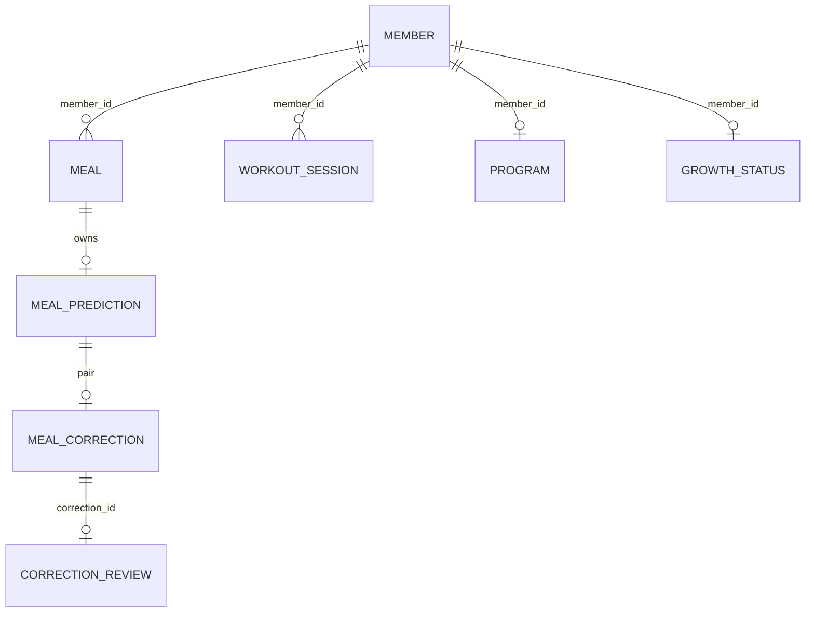
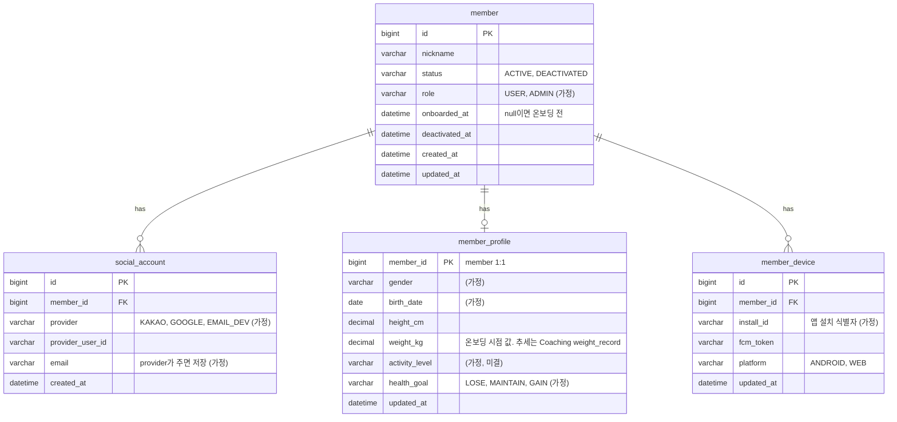
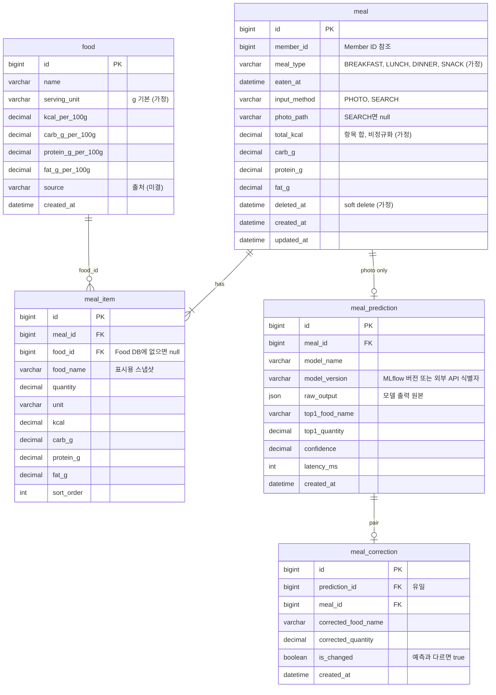
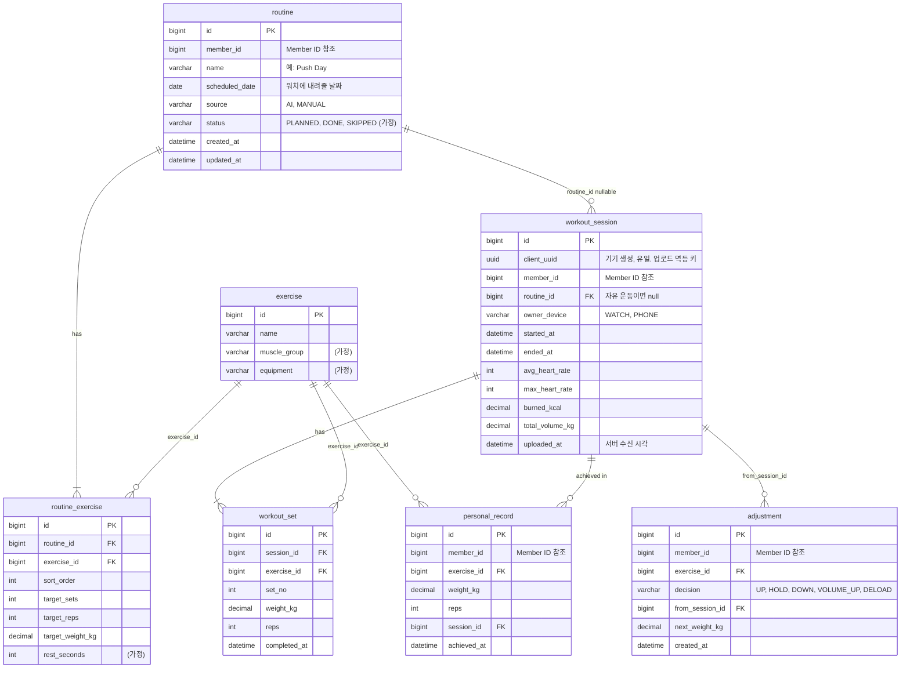
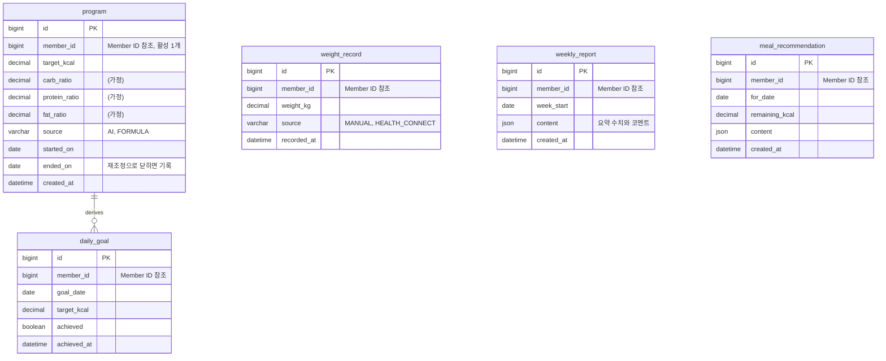
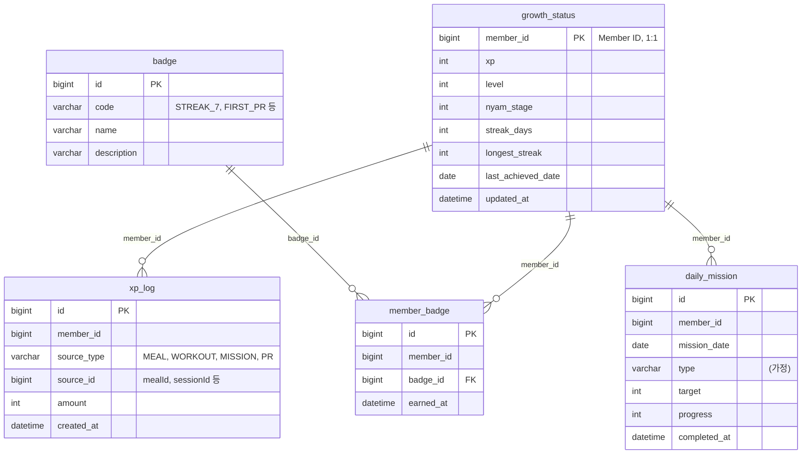
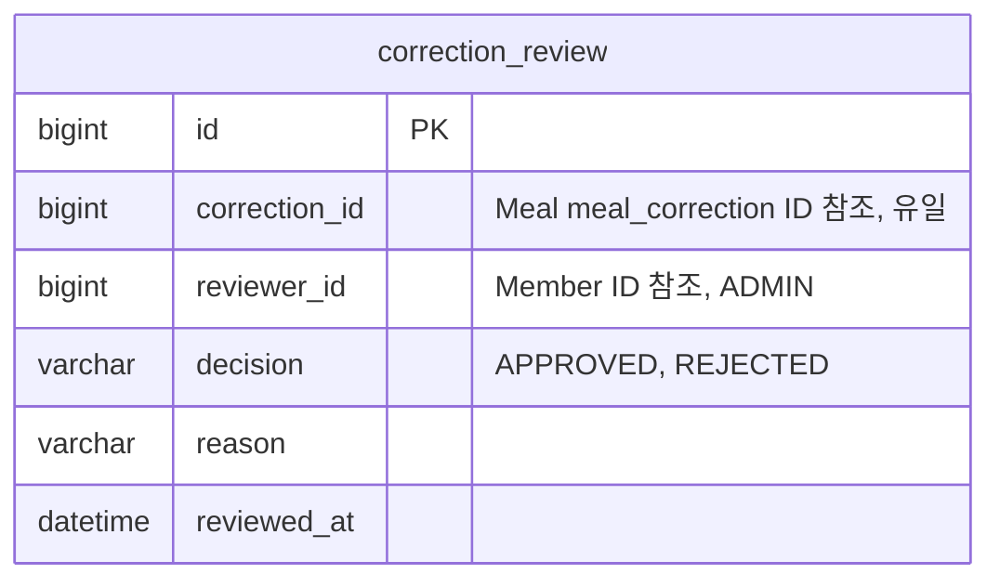

# 논리 ERD

| 항목 | 값 |
|---|---|
| 상태 | 초안 (제안). 1주차 "ERD" 마일스톤의 출발점. D와 각 도메인 소유자 확정 전 |
| 범위 | MySQL 업무 DB(Spring만 쓰기). 폰·워치 Room은 11장에서 범위만 적는다 |
| 관련 | [기획서 3.1·5.2](../renewal/plan.md), [이벤트 목록](../renewal/events.md), [스키마 규칙](./schema-rules.md), [ADR-0003](../adr/0003-phone-offline-workout-only.md), [ADR-0007](../adr/0007-backend-feature-package.md), [ADR-0008](../adr/0008-domain-events.md), [ADR-0011](../adr/0011-mlflow-and-ai-ml-split.md), [ADR-0013](../adr/0013-rest-fcm-sse.md) |

논리 모델이므로 타입은 뜻만 적는다. 물리 타입·길이·인덱스 이름은 [스키마 규칙](./schema-rules.md)을 따른다.
`(가정)`은 작성자가 채운 초안이다. 테이블 이름 중 `meal_prediction`·`meal_correction`·`correction_review`(ADR-0011)와
`member_device`(ADR-0013)는 이미 ADR에 적힌 이름이다.

## 1. 도메인 간 참조 규칙

- 테이블은 소유 도메인의 패키지 `domain/{x}/entity/`에만 매핑한다. 다른 도메인의 entity·repository를 쓰지 않는다(ADR-0007·0008).
- 도메인 경계를 넘는 참조는 **ID 값만** 둔다(`member_id`처럼). JPA 연관관계를 걸지 않고, DB 외래 키도 선언하지 않는다 (가정, 스키마 규칙 5장).
- 다른 도메인의 상세가 필요하면 그 도메인의 공개 조회 서비스를 부른다. 조인하지 않는다.
- 이벤트로 넘어온 ID(`mealId`, `sessionId`)는 멱등 키로 저장한다(`xp_log.source_id` 등).

위 그림은 도메인 사이의 ID 참조만 보여준다. 도메인 안의 관계는 아래 절에 있다.

## 2. Member

소유 C. 계정·온보딩·프로필·기기.

- `social_account(provider, provider_user_id)` 유일. 한 회원에 provider당 하나.
- `member_device(member_id, install_id)` 유일. 같은 기기의 토큰은 덮어쓴다(REQ-MEMBER-12).
- 인증 토큰·블랙리스트는 Redis에 둔다 (가정). 테이블 없음.

## 3. Meal

소유 A. 식사 기록과 예측·수정 쌍.

- `meal_prediction`·`meal_correction`은 식사가 삭제돼도 남는다(REQ-NF-09). 삭제는 `meal.deleted_at`.
- `meal_correction.prediction_id` 유일. 예측 하나에 확정값 하나.
- `ml/datasets`는 이 세 테이블을 읽기만 한다(ADR-0011). 검수 결과는 Admin의 `correction_review`.

## 4. Workout

소유 B. MVP-2이지만 1주차 ERD에 포함한다. 서버 테이블이며 Room 스키마는 11장.

- `workout_session.client_uuid` 유일. 같은 UUID가 다시 오면 새로 만들지 않고 기존 세션을 돌려준다(ADR-0003).
- 세션은 항상 폰이 업로드한다. 워치 전용 테이블은 없다(ADR-0002).
- `adjustment`는 Coaching이 FastAPI에서 받은 결정을 Workout이 저장한 것이다. 전달 경로는 미결(요구사항 Coaching REQ-COACH-07).

## 5. Coaching

소유 D. 계획·목표·체중·리포트.

- `daily_goal(member_id, goal_date)` 유일. `DailyGoalAchieved`를 하루 1회만 발행하는 근거.
- `weekly_report(member_id, week_start)` 유일.
- 운동 소모 kcal는 저장하지 않고 조회 시점에 Workout 공개 조회 또는 이벤트 수신 값으로 계산한다 (가정, 미결).
- RAG 채팅 이력 테이블은 RAG 스토리에서 결정한다.

## 6. Growth

소유 C. 상태 1행 + 적립 로그 + 뱃지.

- `xp_log(source_type, source_id)` 유일. 이벤트 중복 수신을 걸러내는 멱등 키(REQ-NF-12).
- `member_badge(member_id, badge_id)` 유일.
- 레벨 경계·외형 단계 매핑은 테이블이 아니라 설정에 둔다 (가정, REQ-GROWTH-04·05).

## 7. Admin · ML

소유 E(검수 데이터)·F(관리자 UI). Spring 테이블은 검수 하나다. 데이터셋 버전·모델 버전·지표는 MLflow에 있다(ADR-0011).

- `correction_review.correction_id` 유일. 수정 하나에 검수 결과 하나. 재검수는 행을 갱신한다 (가정).
- `ml/datasets`는 `APPROVED`인 correction만 읽어 데이터셋을 만든다.

## 8. 이벤트와 테이블의 대응

| 이벤트 | 발행 측 쓰기 | 구독 측 쓰기 |
|---|---|---|
| `MemberOnboarded` | `member.onboarded_at`, `member_profile` | `program`, `daily_goal` / `growth_status` |
| `MealRecorded` | `meal`, `meal_item`, (`meal_prediction`, `meal_correction`) | `daily_goal.achieved` 평가 / `xp_log`, `growth_status` |
| `MealCorrected` | 위와 같음 | 없음(검수는 관리자가 `correction_review`에) |
| `WorkoutSessionCompleted` | `workout_session`, `workout_set`, `personal_record` | `adjustment`(경로 미결) / `xp_log`, `member_badge` |
| `WeightRecorded` | `weight_record` | `program`(재조정 시 새 행) |
| `DailyGoalAchieved` | `daily_goal.achieved_at` | `growth_status.streak_days`, `member_badge` |

## 9. 미결

| 항목 | 결정자 | 기한 |
|---|---|---|
| 식별자 타입(BIGINT 자동 증가 vs UUID). 전 테이블 규약이라 ADR 대상 | D | 1주차 |
| 도메인 간 DB 외래 키 선언 여부 | D | 1주차 |
| 신체 정보 항목(활동량 포함 여부) | C·D | 2주차 |
| 운동 소모 kcal 저장 위치 | D·B | MVP-2 이전 |
| `adjustment` 저장 주체와 전달 경로 | D·B | MVP-2 이전 |
| Food DB 출처와 적재 | A·E | 2주차 |

## 10. 변경 절차

1. 이 문서를 먼저 고친다(해당 도메인 절). 다른 도메인이 참조하는 ID·이벤트가 바뀌면 상대 소유자를 리뷰어로 넣는다.
2. 같은 MR에서 마이그레이션 파일과 entity를 바꾼다([스키마 규칙 7장](./schema-rules.md)).
3. backend 영역 엄격 판정(트리거 1)이다. D 승인 후 병합한다.

## 11. 폰·워치 Room (범위만)

- Room은 `:core`의 Workout 테이블만 가진다(ADR-0003). 세션·세트·업로드 상태(`pending_upload`)를 두고 `client_uuid`를 서버와 공유한다.
- 워치 Room은 세션·세트를 로컬에 먼저 쓰고 폰 연결 시 Data Layer로 넘긴다(ADR-0002).
- 스키마 내보내기와 마이그레이션 테스트 방식은 첫 Workout 테이블 확정 때 B가 정한다(android/README "결정 필요").
